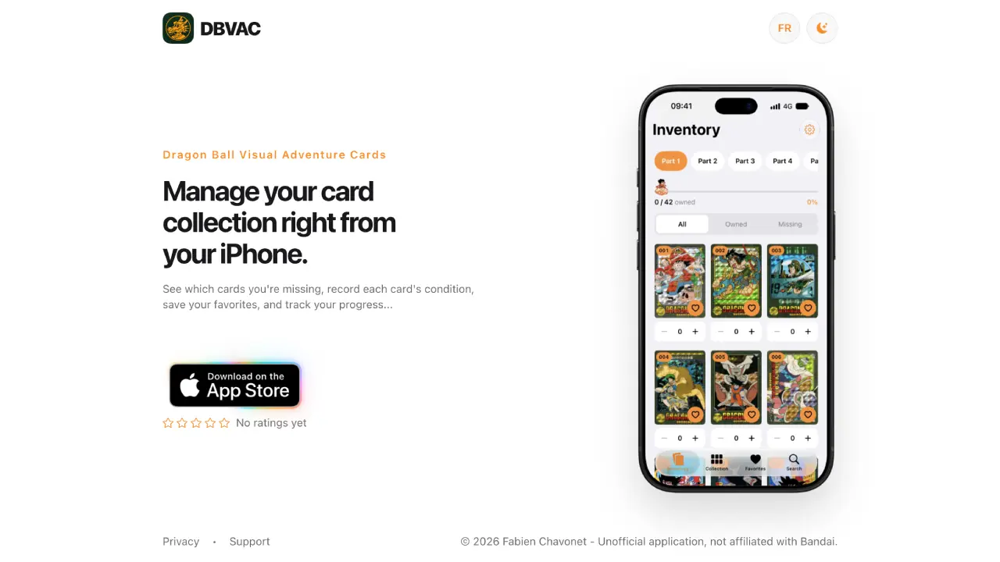
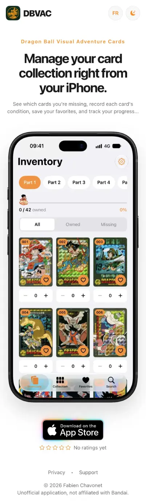

# Dragon Ball Visual Adventure Cards: Landing Page

## Description

This project is the landing page for DBVAC (Dragon Ball Visual Adventure Cards), an iPhone application for managing a Dragon Ball Visual Adventure card collection.

## Objectives

- Create a responsive landing page for mobile and desktop devices.
- Present the application and its main features through a clear and simple interface.
- Offer English and French translations.
- Support light and dark themes.
- Display an iPhone mockup that adapts to the selected theme and language.
- Provide access to privacy and support information through modals and direct links.
- Prepare the App Store download button and the application rating display.

## Tech Stack


## File Description

| **FILE**     | **DESCRIPTION**                                                         |
| :----------: | ----------------------------------------------------------------------- |
| `assets`     | Contains the resources required for the repository.                     |
| `docs`       | Privacy and support documents in English and French.                    |
| `index.html` | Main page structure, responsive layout and modal containers.            |
| `script.js`  | Language switching, image updates, Markdown loading and copyright year. |
| `CNAME`      | Defines the custom domain name for the website.                         |
| `README.md`  | The README file you are currently reading 😉.                           |

## Installation & Usage

### Installation

1. Clone this repository:
    - Open your preferred Terminal.
    - Navigate to the directory where you want to clone the repository.
    - Run the following command:

```
git clone https://github.com/fchavonet/full_stack-db_visual_adventure_cards-landing_page.git
```

2. Open the cloned repository.

3. Start a local web server from the project directory:

```
python3 -m http.server 8000
```

4. Open [http://localhost:8000](http://localhost:8000) in your web browser.

> The project must be served through HTTP because JSON translations and Markdown documents are loaded using the Fetch API. Opening index.html directly from the file system may prevent this content from loading.

### Usage

1. Use the language button to switch between English and French.
2. Use the theme button to switch between light and dark mode.
3. Click Privacy or Support to open the corresponding document.

You can also test the project online by clicking [here](https://www.dbvac.app).

<table align="center">
    <tr>
        <th align="center" style="text-align: center;">Desktop view</th>
        <th align="center" style="text-align: center;">Mobile view</th>
    </tr>
    <tr valign="top">
        <td align="center">
            <picture>
                <source media="(prefers-color-scheme: light)" srcset="./assets/images/screenshots/desktop_page_screenshot-light.webp">
                <source media="(prefers-color-scheme: dark)" srcset="./assets/images/screenshots/desktop_page_screenshot-dark.webp">
                
            </picture>
        </td>
        <td align="center">
            <picture>
                <source media="(prefers-color-scheme: light)" srcset="./assets/images/screenshots/mobile_page_screenshot-light.webp">
                <source media="(prefers-color-scheme: dark)" srcset="./assets/images/screenshots/mobile_page_screenshot-dark.webp">
                
            </picture>
        </td>
    </tr>
</table>

## What's Next?

- Add the App Store link once the application is published.
- Display the application's average rating and number of ratings from the App Store.
- Replace the static app screenshots with a short demonstration video.

## Thanks

- I would like to thank all those who participated or helped to carry out this project.
- A big thank you to my friends Pierre and Yoann, always available to test and provide feedback on my projects.

## Author(s)

**Fabien CHAVONET**
- [GitHub](https://github.com/fchavonet)
- [itch.io](https://fchavonet.itch.io/)
- [LinkedIn](https://www.linkedin.com/in/fchavonet/)
- [Portfolio](https://www.fchavonet.dev)
